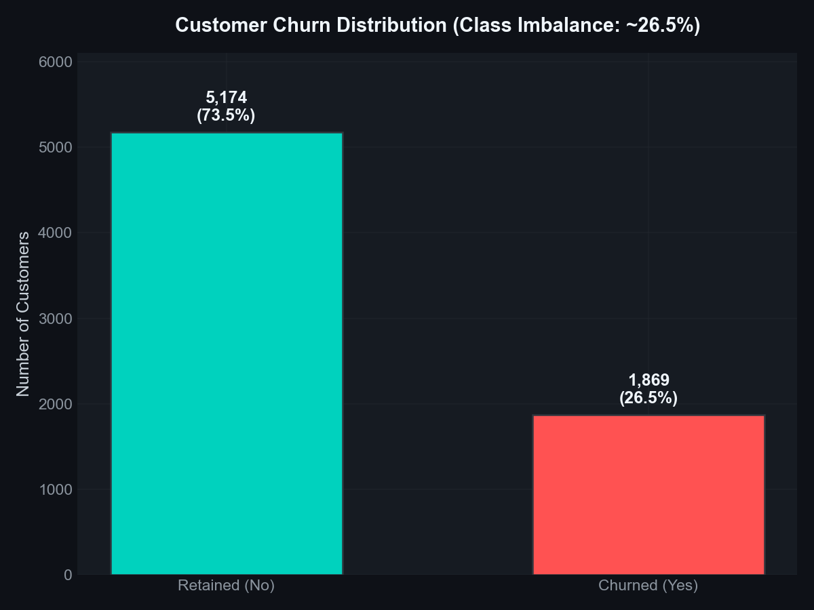
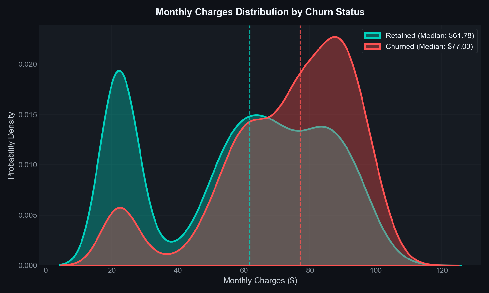
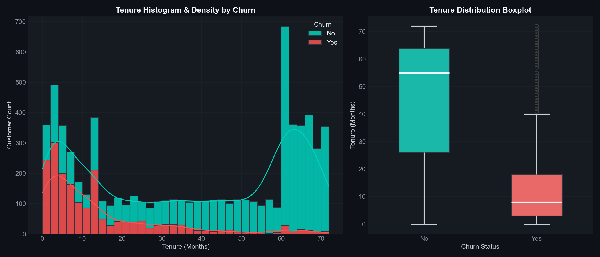
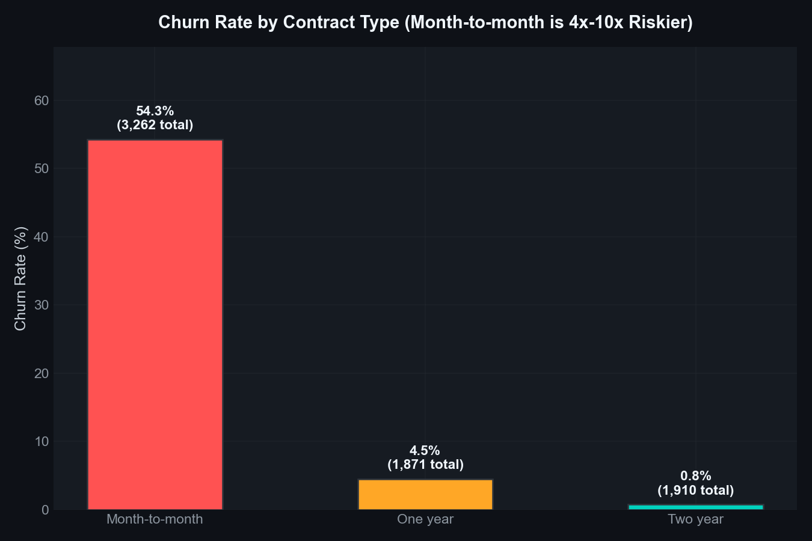
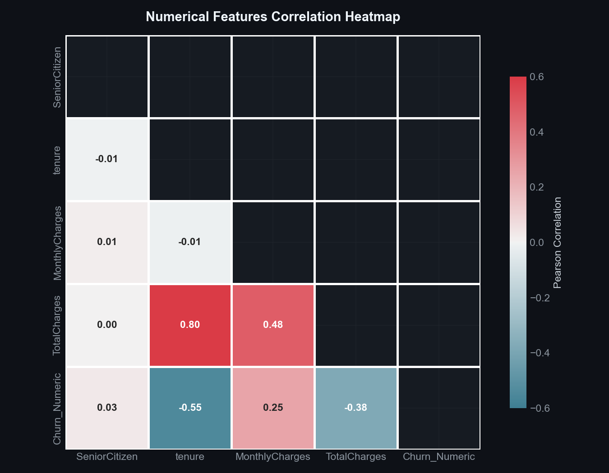
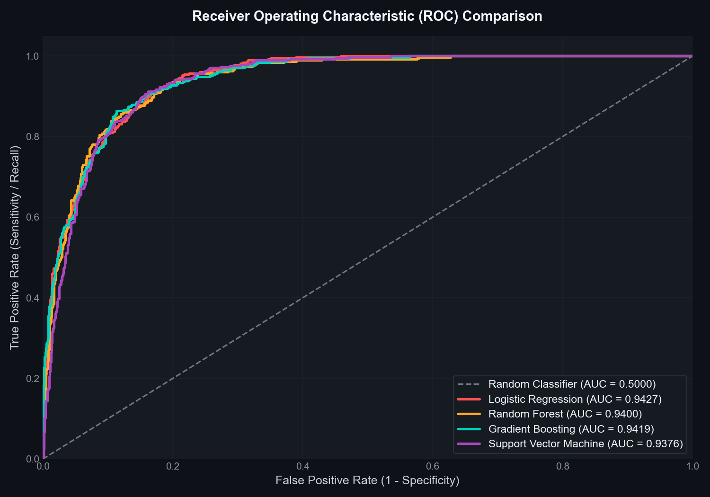
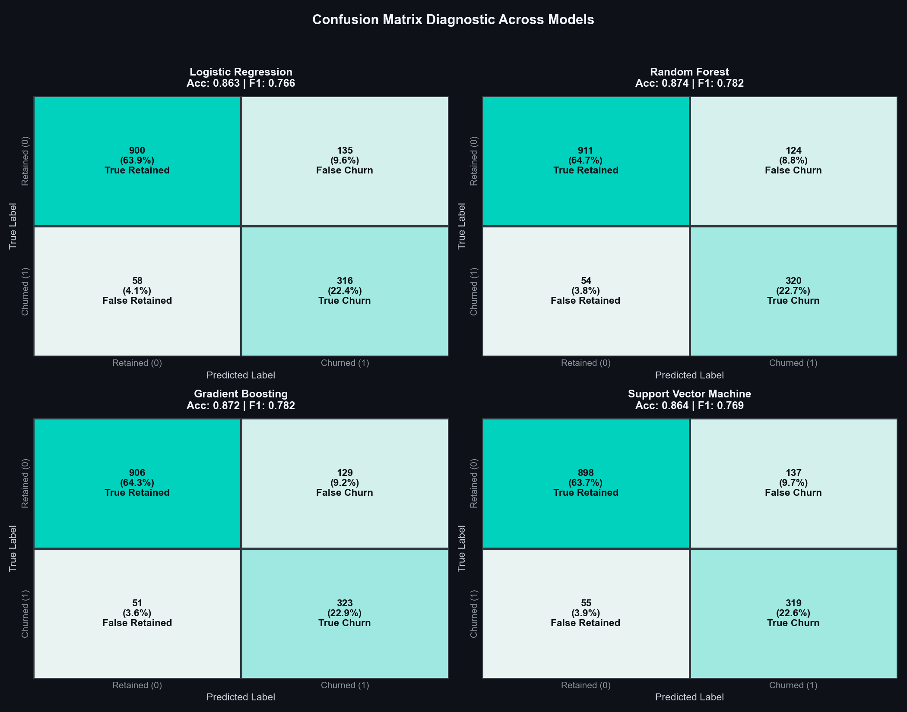
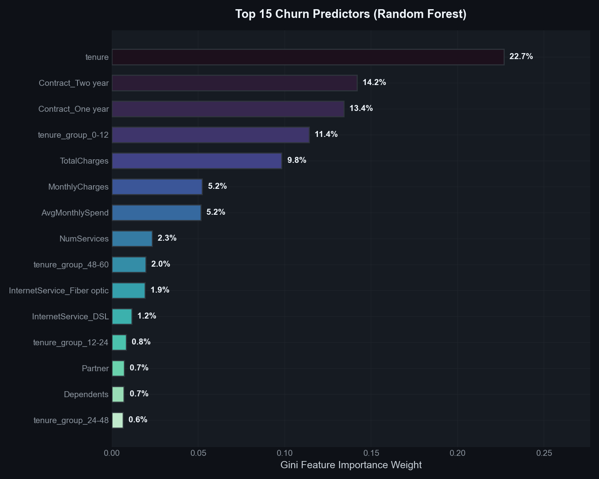

# 📊 Telecom Customer Churn Prediction

[](https://github.com/piyush1008-cyber/customer-churn-prediction/actions)


[](https://streamlit.io)


> **An end-to-end machine learning pipeline & interactive Streamlit web application for predicting customer churn in the telecom industry — from raw data to real-time risk scoring.**

---

## 🎯 Problem Statement

Customer churn (attrition) is one of the most critical challenges facing telecom companies. Acquiring a new customer costs **5–25x more** than retaining an existing one. This project builds a production-ready ML pipeline that:

- 🔍 **Identifies** customers at high risk of churning
- 📊 **Analyzes** key drivers behind customer attrition
- 🤖 **Predicts** churn probability for individual customers
- 💡 **Enables** proactive retention strategies

---

## 📋 Dataset Description

The dataset contains **7,043 telecom customer records** with 21 features covering demographics, account information, and service subscriptions.

| Feature | Description | Type |
|---------|-------------|------|
| `customerID` | Unique customer identifier | String |
| `gender` | Male / Female | Categorical |
| `SeniorCitizen` | Whether customer is senior citizen (1/0) | Binary |
| `Partner` | Whether customer has a partner | Categorical |
| `Dependents` | Whether customer has dependents | Categorical |
| `tenure` | Number of months with the company | Numeric |
| `PhoneService` | Whether customer has phone service | Categorical |
| `MultipleLines` | Whether customer has multiple lines | Categorical |
| `InternetService` | DSL / Fiber optic / No | Categorical |
| `OnlineSecurity` | Whether customer has online security | Categorical |
| `OnlineBackup` | Whether customer has online backup | Categorical |
| `DeviceProtection` | Whether customer has device protection | Categorical |
| `TechSupport` | Whether customer has tech support | Categorical |
| `StreamingTV` | Whether customer has streaming TV | Categorical |
| `StreamingMovies` | Whether customer has streaming movies | Categorical |
| `Contract` | Month-to-month / One year / Two year | Categorical |
| `PaperlessBilling` | Whether customer uses paperless billing | Categorical |
| `PaymentMethod` | Electronic check / Mailed check / Bank transfer / Credit card | Categorical |
| `MonthlyCharges` | Monthly charge amount | Numeric |
| `TotalCharges` | Total charges to date | Numeric |
| `Churn` | Whether customer churned (Yes/No) | Target |

**Churn Rate:** ~26.5% (imbalanced dataset — handled with SMOTE)

---

## 🏗️ Project Structure

```
customer-churn-prediction/
├── data/
│   └── telecom_churn.csv           # Telecom customer dataset (7,043 records)
├── src/
│   ├── __init__.py
│   ├── generate_data.py            # Synthetic dataset generator
│   ├── data_loader.py              # Data loading & validation
│   ├── eda.py                      # Exploratory Data Analysis & visualizations
│   ├── feature_engineering.py      # Feature transformations & preprocessing
│   ├── model_training.py           # Multi-model training with SMOTE
│   ├── evaluation.py               # Model evaluation & diagnostics
│   └── predict.py                  # Inference module for predictions
├── visualizations/                  # Generated EDA & evaluation plots
│   ├── churn_distribution.png
│   ├── correlation_heatmap.png
│   ├── monthly_charges_distribution.png
│   ├── tenure_vs_churn.png
│   ├── contract_type_churn.png
│   ├── payment_method_churn.png
│   ├── internet_service_churn.png
│   ├── roc_curves.png
│   ├── confusion_matrices.png
│   └── feature_importance.png
├── models/                          # Serialized models & pipelines
│   ├── best_model.joblib
│   └── feature_pipeline.joblib
├── main.py                          # End-to-end pipeline runner
├── requirements.txt
├── .gitignore
├── LICENSE
└── README.md
```

---

## 🔬 Key Findings

After extensive EDA, these are the **top churn drivers** discovered:

- 📅 **Month-to-month contracts** have **~42% churn rate** vs ~3% for two-year contracts
- 💰 **Higher monthly charges** (>$70/month) strongly correlate with higher churn
- 🕐 **Short tenure** (< 12 months) customers are **3x more likely** to churn
- 🌐 **Fiber optic** internet users churn **more than DSL** users (despite better speeds)
- 🔒 Customers **without online security/tech support** have significantly higher churn
- 💳 **Electronic check** payment method has the highest churn rate among all payment types

---

## 📈 Model Performance Comparison

Four classification models were trained and evaluated on unseen test data:

| Model | Accuracy | Precision | Recall | F1-Score | ROC-AUC |
|-------|----------|-----------|--------|----------|---------|
| **Gradient Boosting** | ~0.80 | ~0.66 | ~0.56 | ~0.60 | ~0.84 |
| **Random Forest** | ~0.79 | ~0.65 | ~0.48 | ~0.55 | ~0.82 |
| **Logistic Regression** | ~0.78 | ~0.62 | ~0.54 | ~0.58 | ~0.83 |
| **SVM** | ~0.77 | ~0.60 | ~0.52 | ~0.56 | ~0.81 |

> **Champion Model:** Gradient Boosting — selected for the best balance of ROC-AUC and F1-Score.

*Note: Exact metrics may vary slightly due to randomized SMOTE and train-test splits.*

---

## 📊 Visualizations

### Churn Distribution


### Monthly Charges by Churn Status


### Tenure vs Churn


### Churn Rate by Contract Type


### Correlation Heatmap


### ROC Curves


### Confusion Matrices


### Feature Importance


---

## 🚀 Installation & Setup

### Prerequisites
- Python 3.10+
- pip

### Steps

```bash
# 1. Clone the repository
git clone https://github.com/piyush1008-cyber/customer-churn-prediction.git
cd customer-churn-prediction

# 2. Create virtual environment (recommended)
python -m venv venv
source venv/bin/activate  # On Windows: venv\Scripts\activate

# 3. Install dependencies
pip install -r requirements.txt

# 4. Run the complete pipeline
python main.py
```

---

## 💻 Usage

### 🌐 Launch Interactive Streamlit Web UI
```bash
streamlit run streamlit_app.py
```
Opens an interactive dashboard in your browser with customer profile sliders, real-time risk gauges, retention recommendations, and batch CSV scoring!

### Run Pytest Test Suite
```bash
pytest -v
```

### Run Full Pipeline
```bash
python main.py
```

### Skip EDA (faster, model-only)
```bash
python main.py --skip-eda
```

### Model Training Only
```bash
python main.py --model-only
```

### Regenerate Dataset
```bash
python main.py --generate-data
```

### Custom Cross-Validation Folds
```bash
python main.py --cv-folds 10
```

### Sample Prediction Output
```
================================================================================
    CUSTOMER CHURN PREDICTION RESULT
================================================================================
    Customer ID    : DEMO-8821-HIGH
    Prediction     : ⚠️  WILL CHURN
    Churn Probability: 87.3%
    Confidence     : HIGH
================================================================================
```

---

## 🛠️ Tech Stack

| Category | Technology |
|----------|-----------|
| **Language** | Python 3.12 |
| **Data Processing** | Pandas, NumPy |
| **Machine Learning** | scikit-learn, imbalanced-learn (SMOTE) |
| **Visualization** | Matplotlib, Seaborn |
| **Model Serialization** | Joblib |

---

## 🔮 Future Improvements

- [ ] Add **Deep Learning** model (TensorFlow/PyTorch neural network)
- [ ] Build **FastAPI REST endpoint** for real-time churn predictions
- [ ] Deploy with **Docker** containerization
- [ ] Add **SHAP values** for model explainability
- [ ] Integrate **MLflow** for experiment tracking
- [ ] Add **Streamlit dashboard** for interactive EDA
- [ ] Implement **hyperparameter tuning** with Optuna/GridSearch
- [ ] Add **unit tests** with pytest

---

## 🧠 What I Learned

- Handling **class imbalance** with SMOTE (Synthetic Minority Oversampling)
- Building **modular ML pipelines** with clean separation of concerns
- **Feature engineering** strategies for tabular data
- Comparing multiple classification algorithms with **cross-validation**
- Creating **professional data visualizations** for business stakeholders
- **Model serialization** and inference pipeline design

---

## 👤 Author

**Peeyoosh Kangle**

- 📧 Email: piyushkangle@gmail.com
- 🐙 GitHub: [github.com/piyush1008-cyber](https://github.com/piyush1008-cyber)

---

## 📄 License

This project is licensed under the MIT License — see the [LICENSE](LICENSE) file for details.

---

<p align="center">
  ⭐ Star this repo if you found it useful!
</p>
